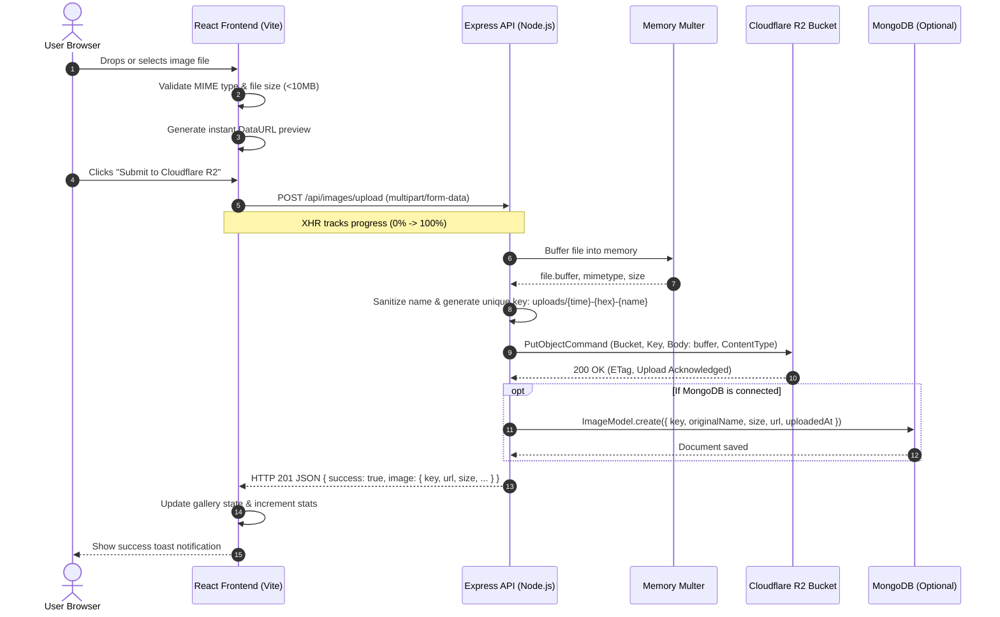

# Cloudflare R2 Integration Documentation


> **Project:** Cloudflare R2 Image Studio (MERN Stack)  
> **Storage Provider:** Cloudflare R2 (AWS S3-Compatible API)  
> **Last Verified:** October 2026  
> **Audience:** Any software engineer or DevOps maintainer integrating, maintaining, or replicating this system.

---

## Table of Contents

1. [Overview](#1-overview)
2. [Cloudflare Account Setup](#2-cloudflare-account-setup)
3. [Required Credentials and Environment Variables](#3-required-credentials-and-environment-variables)
4. [Architecture and Upload Workflow](#4-architecture-and-upload-workflow)
5. [Project Folder Structure](#5-project-folder-structure)
6. [API Documentation](#6-api-documentation)
7. [Image Storage and Access](#7-image-storage-and-access)
8. [Cloudflare R2 Pricing and Free Tier](#8-cloudflare-r2-pricing-and-free-tier)
9. [Security Best Practices](#9-security-best-practices)
10. [Installation and Setup](#10-installation-and-setup)
11. [Troubleshooting](#11-troubleshooting)
12. [Maintenance and Handover](#12-maintenance-and-handover)
13. [Final Verification Checklist](#13-final-verification-checklist)

---

## 1. Overview

### What Cloudflare R2 Is and Why We Use It

**Cloudflare R2** is an S3-compatible, globally distributed object storage service provided by Cloudflare. In this application, Cloudflare R2 serves as the primary binary storage layer for all user-uploaded images.

Instead of writing custom proprietary storage logic, R2 is fully compatible with the standard **AWS S3 API**. This allows our Node.js/Express backend to communicate with R2 using the industry-standard `@aws-sdk/client-s3` library without being locked into Amazon Web Services.

### How R2 Stores Images and Files

Object storage differs fundamentally from a traditional hierarchical file system (like your local hard drive) or a relational database:
- **Objects, Not Files on Disk**: Every stored item is an "object" consisting of data (the file buffer), a unique identifier called the **Object Key** (e.g., `uploads/1741874533-a8f19b-avatar.png`), and metadata (Content-Type, size, upload timestamp).
- **Flat Bucket Architecture**: Buckets have no physical nested folders. Forward slashes in keys (like `uploads/`) are logical prefixes, allowing organized querying while maintaining high-throughput flat key-value access.
- **Global Distribution**: Data uploaded to R2 is distributed across Cloudflare’s global edge network, minimizing read latency for users worldwide.

### Benefits of Using R2 Over Local Server Storage

| Feature | Local Disk Storage (Traditional) | Cloudflare R2 Object Storage (Our Setup) |
| :--- | :--- | :--- |
| **Scalability** | Limited by local server disk capacity; requires disk resize. | Virtually limitless auto-scaling storage without provisioning. |
| **Stateless Servers** | Servers are stateful. Redeploying or auto-scaling drops or orphans files. | Servers remain 100% stateless. App containers can reboot or scale without data loss. |
| **Bandwidth / Egress Costs** | Expensive server egress bandwidth charges. | **Zero egress fees**. Cloudflare R2 charges $0 for external egress traffic. |
| **Availability & Redundancy** | Single point of failure if the server disk corrupts. | Automatic multi-region durability and 99.999999999% (eleven 9s) annual durability. |
| **Performance** | Server CPU and network are bogged down serving static assets. | Direct edge delivery or CDN caching offloads image traffic entirely. |

### Understanding Storage, API Operations, Bandwidth, and Monthly Credits

Cloudflare R2 usage is evaluated across three distinct dimensions:
1. **Storage (GB-Month)**: The average volume of stored data across the billing cycle. Storing a 10 GB file for an entire 30-day month consumes `10 GB-month`.
2. **Class A Operations (Mutations)**: State-changing requests, such as writing an object (`PutObject`), listing bucket contents (`ListObjectsV2`), or creating multipart uploads.
3. **Class B Operations (Reads)**: Read requests, such as retrieving an object (`GetObject`), reading object metadata (`HeadObject`), or checking bucket configurations.
4. **Bandwidth (Data Egress)**: Data transferred out from storage to users over the Internet. Unlike AWS S3 (which charges $0.09/GB for egress), **Cloudflare R2 egress is completely free ($0.00)**.
5. **Monthly Credits / Billing**: The free tier allowances renew on the 1st of every calendar month. Unused operation credits do not roll over.

---

## 2. Cloudflare Account Setup

Follow these exact steps to prepare Cloudflare R2 for this application:

### Step 2.1: Create a Cloudflare Account
1. Visit [dash.cloudflare.com](https://dash.cloudflare.com/) and register for a free account.
2. Verify your email address and log in to the Cloudflare dashboard.

### Step 2.2: Create an R2 Bucket
1. In the left navigation sidebar, select **Storage & Databases** > **R2** (or directly **R2**).
2. If prompted, agree to enable the R2 service (a payment card may be requested for identity verification, but nothing is charged within free tier limits).
3. Click **Create bucket**.
4. Enter a globally unique bucket name (for example: `image-studio-production`).
5. **Storage Class**: Select **Standard** (this is default and optimal for active image galleries).
6. **Location Hint**: Select **Automatic** (Cloudflare automatically chooses the closest data center) or specify a geographic region closest to your primary audience (e.g., `North America East` or `Western Europe`).
7. Click **Create Bucket**.

### Step 2.3: Configure Public Access or Custom Domain
For images to be visible in the browser, the R2 bucket must be accessible via HTTP/HTTPS:
1. Open your newly created bucket from the R2 dashboard.
2. Click on the **Settings** tab.
3. Scroll down to the **Public Access** section:
   - **Option A (Free R2.dev Subdomain)**: Under **R2.dev Subdomain**, click **Allow Access**. Type `allow` to confirm. Cloudflare will assign a public URL like `https://pub-xxxxxxxxxxxxxxxxxxxxxxxx.r2.dev`. Copy this URL.
   - **Option B (Custom Domain)**: Under **Custom Domains**, click **Connect Domain**. Enter a subdomain you own on Cloudflare (e.g., `images.yourdomain.com`). Cloudflare manages the SSL certificate and CDN caching automatically.
4. Keep this URL handy; it will become your `R2_PUBLIC_URL`.

### Step 2.4: Create an R2 API Token (S3 Credentials)
1. Go back to the main **R2** dashboard overview.
2. In the right-hand panel, click **Manage R2 API Tokens**.
3. Click **Create API token**.
4. Configure the token:
   - **Token Name**: `mern-r2-image-uploader-token`
   - **Permissions**: Select **Object Read & Write** (this allows `PutObject`, `GetObject`, `ListObjectsV2`, and `DeleteObject`).
   - **Specify bucket(s)**: Select **Apply to specific bucket only** and pick the bucket you created in Step 2.2 (Principle of Least Privilege).
   - **TTL**: Leave blank or set an expiration policy according to your company security policy.
5. Click **Create API Token**.
6. Cloudflare displays the credentials **once only**:
   - **Access Key ID**: (e.g., `a1b2c3d4e5f6...`)
   - **Secret Access Key**: (e.g., `7890abcdef123456...`)
   - **Account ID**: Displayed on the token summary or under the R2 Overview page sidebar.

---

## 3. Required Credentials and Environment Variables

All R2 credentials must be kept strictly on the server in [`backend/.env`](file:///c:/Users/kabil/Desktop/Antigravity/S3-cloudfare/backend/.env). **Never expose these to the frontend or version control.**

### Environment Variables Reference Table

| Variable Name | Required | Default / Example | Where to Find in Cloudflare | Purpose |
| :--- | :--- | :--- | :--- | :--- |
| `PORT` | Yes | `5000` | Local configuration | Port on which the Express server listens. |
| `R2_ACCOUNT_ID` | Yes | `a1b2c3d4e5f6a7b8c9` | R2 Overview page (right sidebar) or API token details | Identifies your Cloudflare account to construct the S3 endpoint: `https://<ID>.r2.cloudflarestorage.com`. |
| `R2_ACCESS_KEY_ID` | Yes | `3f8a02b1c4d9...` | API Token creation page | The AWS S3 compatible Access Key used to sign requests. |
| `R2_SECRET_ACCESS_KEY` | Yes | `9a8b7c6d5e4f...` | API Token creation page | The AWS S3 compatible Secret Key used to cryptographically sign requests. |
| `R2_BUCKET_NAME` | Yes | `image-studio-production` | Bucket settings | The exact target R2 bucket name where objects are uploaded. |
| `R2_PUBLIC_URL` | Yes | `https://pub-xxxx.r2.dev` | Bucket Settings > Public Access | Base public HTTPS URL used to serve images directly to client browsers. |
| `MAX_FILE_SIZE_MB` | No | `10` | Local configuration | Enforces maximum upload payload in megabytes (defaults to 10MB). |
| `MONGO_URI` | No | `mongodb://localhost:27017/r2_app` | MongoDB Atlas or local | Optional connection string to persist metadata in MongoDB. |

### Placeholder Example (`backend/.env.example`)

```env
# Server Configuration
PORT=5000

# Cloudflare R2 Credentials (AWS S3-Compatible)
R2_ACCOUNT_ID=your_cloudflare_account_id
R2_ACCESS_KEY_ID=your_r2_access_key_id
R2_SECRET_ACCESS_KEY=your_r2_secret_access_key
R2_BUCKET_NAME=your_r2_bucket_name

# Public bucket URL (e.g., https://pub-xxxxxxxx.r2.dev or custom domain https://images.yourdomain.com)
R2_PUBLIC_URL=https://pub-yourbucketid.r2.dev

# Upload Limit in Megabytes
MAX_FILE_SIZE_MB=10

# Optional: MongoDB URI for MERN metadata persistence
# MONGO_URI=mongodb://localhost:27017/r2_image_gallery
```

### Git Protection

Both [`backend/.gitignore`](file:///c:/Users/kabil/Desktop/Antigravity/S3-cloudfare/backend/.gitignore) and the root [`.gitignore`](file:///c:/Users/kabil/Desktop/Antigravity/S3-cloudfare/.gitignore) explicitly exclude `.env`:

```gitignore
node_modules/
.env
.env.local
.env.*.local
dist/
*.log
```

---

## 4. Architecture and Upload Workflow

### Step-by-Step Data Flow

1. **User Action in React Frontend**:
   - The user selects an image using the file input or drag-and-drop zone in [`ImageUpload.jsx`](file:///c:/Users/kabil/Desktop/Antigravity/S3-cloudfare/frontend/src/components/ImageUpload.jsx).
2. **Frontend Validation & Preview**:
   - Client checks file MIME type (`image/*`) and file size (`<= 10MB`).
   - If valid, a client-side thumbnail preview is generated using `FileReader.readAsDataURL()` and shown to the user.
3. **Submission**:
   - The user clicks **Submit to Cloudflare R2**.
   - An `XMLHttpRequest` is initiated with a `multipart/form-data` payload containing the file under form field `image`.
   - The client monitors `xhr.upload.onprogress` and renders an animated progress percentage bar.
4. **Express Middleware Validation**:
   - Express receives the request at `POST /api/images/upload`.
   - Multer middleware in [`uploadMiddleware.js`](file:///c:/Users/kabil/Desktop/Antigravity/S3-cloudfare/backend/middlewares/uploadMiddleware.js) handles memory buffering (`multer.memoryStorage()`).
   - Server validates MIME type against whitelist (`image/jpeg`, `image/png`, `image/webp`, `image/gif`, `image/svg+xml`, `image/avif`) and enforces file size limit.
5. **R2 Upload via AWS S3 SDK**:
   - [`imageController.js`](file:///c:/Users/kabil/Desktop/Antigravity/S3-cloudfare/backend/controllers/imageController.js) generates a collision-resistant key: `uploads/<timestamp>-<randomHex>-<sanitizedName>`.
   - The server creates a `PutObjectCommand` and transmits the buffer directly to R2 using the initialized `S3Client`.
6. **Persistence & Response**:
   - If MongoDB is connected, a metadata record is written to the database.
   - The backend constructs the final public URL (`${R2_PUBLIC_URL}/${key}`) and returns HTTP 201 with the image details.
7. **UI Update**:
   - React receives the response, appends the newly created image object to local state, plays a success toast alert, and updates metrics (Total Images & Storage Used).

### Mermaid Architecture & Sequence Diagram



---

## 5. Project Folder Structure

### Directory Tree & Responsibilities

```text
S3-cloudfare/
├── backend/
│   ├── config/
│   │   ├── db.js                      # Connects to MongoDB if MONGO_URI is set; provides graceful fallback for pure R2 mode.
│   │   └── r2.js                      # Instantiates and exports S3Client configured for Cloudflare R2 endpoint and credentials.
│   ├── controllers/
│   │   └── imageController.js         # Core business logic: handles uploads, lists objects from R2, deletes objects, and streaming fallback.
│   ├── middlewares/
│   │   └── uploadMiddleware.js        # Multer memory storage configuration, MIME type validation filter, and error handler.
│   ├── models/
│   │   └── Image.js                   # Mongoose Image schema for storing metadata when MongoDB is present.
│   ├── routes/
│   │   └── imageRoutes.js             # Route declarations mapping endpoints (/upload, /, /:key, /file/*) to controllers.
│   ├── .env                           # Local environment file containing R2 secrets (ignored by Git).
│   ├── .env.example                   # Template documenting required environment variable names.
│   ├── .gitignore                     # Prevents node_modules and .env from being tracked by Git.
│   ├── package.json                   # Backend dependencies: @aws-sdk/client-s3, express, multer, cors, dotenv, mongoose, morgan.
│   └── server.js                      # Express application setup, CORS policy, Morgan logging, health route, and port binding.
│
├── frontend/
│   ├── public/                        # Static public assets.
│   ├── src/
│   │   ├── components/
│   │   │   ├── ConfirmModal.jsx       # Modal dialog asking for confirmation before permanently deleting an image from R2.
│   │   │   ├── ImageGallery.jsx       # Renders responsive grid of image cards with search filter, copy URL, preview, and delete buttons.
│   │   │   ├── ImageModal.jsx         # Full-screen lightbox previewing the full-resolution image and detailed S3 metadata.
│   │   │   ├── ImageUpload.jsx        # Drag-and-drop dropzone, live image preview box, and upload progress bar.
│   │   │   ├── Navbar.jsx             # Top bar with branding, S3-compatible badge, connected bucket name, and API health status.
│   │   │   ├── StatsBar.jsx           # Cards calculating and displaying total images count and total storage size formatted in B/KB/MB.
│   │   │   └── Toast.jsx              # Floating dismissible toast alerts for success, error, and informational messages.
│   │   ├── services/
│   │   │   └── api.js                 # Frontend API helper using fetch and XMLHttpRequest for upload progress tracking.
│   │   ├── App.jsx                    # Root React component managing image gallery state, modals, and toasts.
│   │   ├── index.css                  # Modern Vanilla CSS design system (tokens, dark theme, glassmorphism, responsive grid).
│   │   └── main.jsx                   # React application mount point.
│   ├── index.html                     # HTML page template with Plus Jakarta Sans typography and favicon.
│   ├── package.json                   # Frontend dependencies: react, react-dom, lucide-react, vite.
│   └── vite.config.js                 # Vite bundler configuration including dev proxy forwarder for /api.
│
├── .gitignore                         # Root Git ignore file protecting all workspace environments.
├── package.json                       # Root script orchestrator.
└── README.md                          # Quickstart developer guide.
```

---

## 6. API Documentation

All API endpoints are hosted under `/api`.

### 1. Upload Image to Cloudflare R2
- **Method:** `POST`
- **URL:** `/api/images/upload`
- **Purpose:** Receives an image file via multipart form data, validates it, and uploads the buffer directly to Cloudflare R2 using `@aws-sdk/client-s3`.
- **Request Headers:**
  - `Content-Type: multipart/form-data`
- **Request Body:** Form data with field:
  - `image` *(File, required)*: The image binary file.
- **Validation Rules:**
  - File presence: `image` field must be present.
  - Allowed MIME types: `image/jpeg`, `image/png`, `image/webp`, `image/gif`, `image/svg+xml`, `image/avif`.
  - Max file size: `MAX_FILE_SIZE_MB` (default 10 MB).
- **Success Response:**
  - **Status:** `201 Created`
  - **Payload:**
    ```json
    {
      "success": true,
      "message": "Image uploaded successfully to Cloudflare R2",
      "image": {
        "key": "uploads/1741874533000-a8f19b2c3d4e-avatar.png",
        "originalName": "avatar.png",
        "size": 245120,
        "mimeType": "image/png",
        "url": "https://pub-xxxxxxxx.r2.dev/uploads/1741874533000-a8f19b2c3d4e-avatar.png",
        "uploadedAt": "2026-10-13T06:50:00.000Z"
      }
    }
    ```
- **Error Responses:**
  - **Status `400 Bad Request`** (Invalid MIME or missing file):
    ```json
    {
      "success": false,
      "message": "Invalid file type: application/pdf. Only images (JPEG, PNG, WEBP, GIF, SVG, AVIF) are allowed."
    }
    ```
  - **Status `400 Bad Request`** (Size limit exceeded):
    ```json
    {
      "success": false,
      "message": "File size exceeds the allowed limit of 10MB."
    }
    ```
  - **Status `500 Internal Server Error`** (R2 credentials unconfigured or network failure):
    ```json
    {
      "success": false,
      "message": "Cloudflare R2 credentials are not configured. Please set R2_ACCOUNT_ID..."
    }
    ```

---

### 2. List Uploaded Images from Cloudflare R2
- **Method:** `GET`
- **URL:** `/api/images`
- **Purpose:** Queries Cloudflare R2 using `ListObjectsV2Command` to retrieve all uploaded objects under the `uploads/` prefix.
- **Request Headers:** `Accept: application/json`
- **Request Parameters:** None.
- **Success Response:**
  - **Status:** `200 OK`
  - **Payload:**
    ```json
    {
      "success": true,
      "count": 2,
      "images": [
        {
          "key": "uploads/1741874533000-a8f19b2c3d4e-banner.webp",
          "originalName": "banner.webp",
          "size": 512000,
          "uploadedAt": "2026-10-13T06:50:00.000Z",
          "url": "https://pub-xxxxxxxx.r2.dev/uploads/1741874533000-a8f19b2c3d4e-banner.webp"
        },
        {
          "key": "uploads/1741874510000-f9e8d7c6b5a4-logo.png",
          "originalName": "logo.png",
          "size": 64320,
          "uploadedAt": "2026-10-13T06:45:00.000Z",
          "url": "https://pub-xxxxxxxx.r2.dev/uploads/1741874510000-f9e8d7c6b5a4-logo.png"
        }
      ]
    }
    ```

---

### 3. Delete Image from Cloudflare R2
- **Method:** `DELETE`
- **URL:** `/api/images/:key` (or `/api/images/uploads/filename.png`)
- **Purpose:** Permanently deletes an object from Cloudflare R2 using `DeleteObjectCommand` and removes its metadata from MongoDB (if connected).
- **URL Parameters:**
  - `:key` *(string, required)*: The unique R2 object key (e.g., `uploads/1741874533000-a8f19b2c3d4e-avatar.png`).
- **Success Response:**
  - **Status:** `200 OK`
  - **Payload:**
    ```json
    {
      "success": true,
      "message": "Image 'uploads/1741874533000-a8f19b2c3d4e-avatar.png' deleted successfully from Cloudflare R2",
      "key": "uploads/1741874533000-a8f19b2c3d4e-avatar.png"
    }
    ```
- **Error Response:**
  - **Status `500 Internal Server Error`**:
    ```json
    {
      "success": false,
      "message": "Failed to delete image from Cloudflare R2"
    }
    ```

---

### 4. Streaming Proxy Fallback Route
- **Method:** `GET`
- **URL:** `/api/images/file/*`
- **Purpose:** Streams an image directly from R2 using `GetObjectCommand`. Serves as an automatic fallback if public access has not yet been enabled on the R2 bucket.
- **Headers Returned:**
  - `Content-Type`: Matching the image MIME type (e.g., `image/png`).
  - `Cache-Control: public, max-age=31536000, immutable`

---

### 5. Health & Diagnostic Check
- **Method:** `GET`
- **URL:** `/api/health`
- **Purpose:** Verifies that the server is online and checks whether Cloudflare R2 credentials and bucket configurations are loaded.
- **Success Response:**
  - **Status:** `200 OK`
  - **Payload:**
    ```json
    {
      "status": "online",
      "timestamp": "2026-10-13T06:55:00.000Z",
      "cloudflareR2": {
        "configured": true,
        "bucket": "image-studio-production",
        "publicUrlConfigured": true
      }
    }
    ```

---

## 7. Image Storage and Access

### Key vs. Public URL: Core Distinction

A common point of confusion for developers new to object storage is the difference between an **Object Key** and an **Image URL**:

```text
Storage Key:   uploads/1741874533000-a8f19b2c3d4e-profile_pic.png
               └── Prefix ──┘ └── Timestamp ─┘ └── Random Hex ──┘ └── Clean Name ──┘

Public URL:    https://pub-xxxxxxxx.r2.dev/uploads/1741874533000-a8f19b2c3d4e-profile_pic.png
               └───── R2_PUBLIC_URL ─────┘ └─────────────────── Key ───────────────────┘
```

- **Object Key (`key`)**: The internal S3 identifier inside Cloudflare R2. This is what you pass to `DeleteObjectCommand` or `GetObjectCommand`. It is **not** an HTTP URL.
- **Public URL (`url`)**: The internet-accessible HTTPS address used by browsers (``). It is formed by concatenating `R2_PUBLIC_URL` with the `key`.

### How Object Keys Are Generated to Prevent Collisions

If two users upload an image named `avatar.png`, saving them as `avatar.png` would cause the second upload to overwrite the first.

Our implementation in [`backend/controllers/imageController.js`](file:///c:/Users/kabil/Desktop/Antigravity/S3-cloudfare/backend/controllers/imageController.js#L36-L40) solves this through three layers of collision protection:
```javascript
const sanitizedOriginal = file.originalname.replace(/[^a-zA-Z0-9._-]/g, '_');
const uniqueSuffix = crypto.randomBytes(6).toString('hex');
const key = `uploads/${Date.now()}-${uniqueSuffix}-${sanitizedOriginal}`;
```
1. **Sanitization**: All spaces and special characters are replaced with underscores to prevent URL encoding corruption and path traversal attacks.
2. **Timestamp (`Date.now()`)**: Guarantees chronological sorting and unique prefixes.
3. **Cryptographic Random Hex (`crypto.randomBytes(6)`)**: Adds 12 random hex characters (over 281 trillion combinations), eliminating collisions even if multiple uploads occur at the exact same millisecond.

### Public vs. Private Bucket Access

- **Public Bucket (Configured in this app)**: Cloudflare allows public reads via `https://pub-xxxx.r2.dev` or a custom domain. The browser requests images directly from Cloudflare's edge network, saving server CPU and bandwidth.
- **Private Bucket**: If public access is turned off, files cannot be accessed via direct HTTP. Our backend includes a built-in fallback route (`/api/images/file/*`) using `GetObjectCommand` to stream images securely through the server if needed.

### MongoDB vs. Direct R2 Querying

In this application:
- **Direct Cloudflare R2 Querying**: The `GET /api/images` endpoint uses `ListObjectsV2Command` to query Cloudflare R2 directly. This ensures that what the user sees in the gallery **always reflects what actually exists in R2**, even if files were uploaded or deleted outside the application.
- **MongoDB Integration (MERN Pattern)**: If a `MONGO_URI` is provided in `.env`, [`Image.js`](file:///c:/Users/kabil/Desktop/Antigravity/S3-cloudfare/backend/models/Image.js) synchronously stores file metadata (size, MIME type, upload timestamp). If MongoDB is omitted, the application runs smoothly in standalone R2 mode.

---

## 8. Cloudflare R2 Pricing and Free Tier

Cloudflare R2 provides a generous **monthly recurring free tier** designed for developers and small-to-medium workloads.

### Official Published Free Tier (Every Month)

| Resource | Free Monthly Allowance | Charge Beyond Free Tier |
| :--- | :--- | :--- |
| **Standard Storage** | **10 GB-Month** | $0.015 per GB-month |
| **Class A Operations** (Writes, Lists, Uploads) | **1,000,000 requests / month** | $4.50 per 1,000,000 requests |
| **Class B Operations** (Reads, Head, Downloads) | **10,000,000 requests / month** | $0.36 per 1,000,000 requests |
| **Egress Bandwidth (Data Transfer Out)** | **100% Free ($0.00 / GB)** | **$0.00** (Unlimited free egress) |

> 🔗 **Official Pricing Reference**: Check the latest pricing at [https://developers.cloudflare.com/r2/pricing/](https://developers.cloudflare.com/r2/pricing/).

### Critical Concept: Understanding "GB-Month"

- The free allowance is **10 GB-month**, **NOT** an additional 10 GB of new storage added each month.
- **How GB-Month Works**:
  - If you store 10 GB of images for 30 days, your usage is `10 GB × 1 month = 10 GB-month` (100% free).
  - If you store 20 GB of images for 30 days, your usage is `20 GB-month`. You get 10 GB-month free, and pay for the remaining 10 GB-month ($0.15 for the month).
  - If you upload 20 GB of images halfway through a 30-day month (15 days), your usage is `20 GB × (15/30) = 10 GB-month` (still free).
- Storage does **not** expand indefinitely for free; monitor your bucket volume in the Cloudflare dashboard as your gallery grows.

---

## 9. Security Best Practices

### 1. Strict Server-Side Isolation
- **Rule**: Never import `@aws-sdk/client-s3` or reference `R2_ACCESS_KEY_ID` / `R2_SECRET_ACCESS_KEY` in Vite or React source code.
- **Implementation**: All S3 commands exist strictly inside the Node.js Express layer. The React frontend interacts only with `/api/images/*` endpoints.

### 2. In-Memory Buffering (No Local Disk Footprint)
- Many traditional file upload tutorials write files to `uploads/` on the server disk before uploading to the cloud. This risks filling up server storage, leaves orphan temporary files, and creates local file execution vulnerabilities.
- **Our Implementation**: We use `multer.memoryStorage()`. Images stay in RAM buffers during the lifecycle of the HTTP request and are streamed directly to R2.

### 3. Rigorous MIME Type and Extension Validation
- Validating file extensions (`.jpg`) is insufficient because attackers can rename executable files (`exploit.php.jpg`).
- **Our Implementation**: [`uploadMiddleware.js`](file:///c:/Users/kabil/Desktop/Antigravity/S3-cloudfare/backend/middlewares/uploadMiddleware.js#L3-L10) validates the MIME type (`file.mimetype`) against a strict image-only whitelist:
  ```javascript
  const allowedMimeTypes = [
    'image/jpeg', 'image/png', 'image/webp',
    'image/gif', 'image/svg+xml', 'image/avif'
  ];
  ```

### 4. File Size Limits
- Prevents denial-of-service (DoS) attacks and buffer exhaustion by enforcing `MAX_FILE_SIZE_MB` (default 10 MB) via Multer limits before processing the payload.

### 5. Production Authentication for Delete Operations
- In production applications, ensure the `DELETE /api/images/:key` route is wrapped with authentication middleware (such as JWT verification or session checks) so only authorized administrators can remove images.

---

## 10. Installation and Setup

Follow these copy-paste instructions to run the application from scratch:

### 1. Clone & Enter Project Directory
```powershell
cd c:\Users\kabil\Desktop\Antigravity\S3-cloudfare
```

### 2. Install Dependencies

**Install Backend Dependencies:**
```powershell
cd backend
npm install
```

**Install Frontend Dependencies:**
```powershell
cd ../frontend
npm install
```

### 3. Configure Backend Environment
Copy the example environment file and open `.env`:
```powershell
cd ../backend
cp .env.example .env
```
Edit `backend/.env` with your real Cloudflare R2 credentials:
```env
PORT=5000
R2_ACCOUNT_ID=your_real_account_id
R2_ACCESS_KEY_ID=your_real_access_key
R2_SECRET_ACCESS_KEY=your_real_secret_key
R2_BUCKET_NAME=your_real_bucket_name
R2_PUBLIC_URL=https://pub-yourbucketid.r2.dev
MAX_FILE_SIZE_MB=10
```

### 4. Start the Application

**Terminal 1 — Launch Backend:**
```powershell
cd backend
npm start
```
*Expected output:*
```text
===============================================
🚀 Server running on http://localhost:5000
📦 Cloudflare R2 Bucket: your_real_bucket_name
🌐 R2 Public URL: https://pub-yourbucketid.r2.dev
📡 Endpoints available:
   - POST   /api/images/upload
   - GET    /api/images
   - DELETE /api/images/:key
   - GET    /api/health
===============================================
```

**Terminal 2 — Launch Frontend:**
```powershell
cd frontend
npm run dev
```
*Expected output:*
```text
  VITE v8.3.4  ready in 390 ms
  ➜  Local:   http://localhost:5173/
```

### 5. Verify and Test

1. **Open the App**: Visit `http://localhost:5173/` in your browser.
2. **Verify Header**: Check the top-right status badge: it should say **API Connected** and display your bucket name.
3. **Upload an Image**: Drag and drop any `.png`, `.jpg`, or `.webp` file. Verify the preview appears, then click **Submit to Cloudflare R2**.
4. **Inspect in Cloudflare**: Open your Cloudflare R2 bucket dashboard; the uploaded image will appear with its `uploads/...` key.
5. **Test Copy URL**: Click **Copy URL** on the image card and paste it into a new browser tab to verify public access.
6. **Test Deletion**: Click the trash icon, confirm in the dialog, and verify the card disappears from the gallery and the object is removed from R2.

---

## 11. Troubleshooting

### 1. `write EPROTO ... sslv3 alert handshake failure` / SSL Error
- **Cause**: The `R2_ACCOUNT_ID` in `backend/.env` is incorrect or contains placeholder text.
- **Fix**: Cloudflare S3 endpoints are formed as `https://<R2_ACCOUNT_ID>.r2.cloudflarestorage.com`. Ensure your Account ID is exact (hexadecimal string) with no spaces or typos.

### 2. `InvalidAccessKeyId` or `SignatureDoesNotMatch`
- **Cause**: Incorrect `R2_ACCESS_KEY_ID` or `R2_SECRET_ACCESS_KEY`.
- **Fix**: Re-check your API token credentials. If the secret key was lost or truncated, delete the old token in Cloudflare and generate a new one.

### 3. `NoSuchBucket: The specified bucket does not exist`
- **Cause**: Typo in `R2_BUCKET_NAME` in `backend/.env`.
- **Fix**: Verify the exact bucket name in the Cloudflare R2 dashboard (bucket names are case-sensitive).

### 4. `AccessDenied` / Forbidden (403)
- **Cause**: The R2 API Token was created with insufficient permissions (e.g., "Read" instead of "Object Read & Write"), or restricted to a different bucket.
- **Fix**: Generate a new token with **Object Read & Write** permissions applied to your specific bucket.

### 5. Upload Succeeds, but Images Show Broken Icons (404/403 on Image URL)
- **Cause**: The bucket's public access is disabled, or `R2_PUBLIC_URL` has a trailing slash or incorrect domain.
- **Fix**:
  1. Open the bucket in the Cloudflare dashboard > **Settings** > **Public Access**.
  2. Ensure **R2.dev Subdomain** is set to **Allowed** (or your Custom Domain is active).
  3. Ensure `R2_PUBLIC_URL` in `backend/.env` matches this domain (e.g. `https://pub-xxxx.r2.dev`) without a trailing slash.

### 6. `CORS error` when Opening Direct Image URLs
- **Cause**: Cross-origin policy restricting browser fetches.
- **Fix**: In the Cloudflare R2 bucket dashboard, open **Settings** > **CORS Policy** and allow GET from your frontend origin:
  ```json
  [
    {
      "AllowedOrigins": ["*"],
      "AllowedMethods": ["GET", "HEAD"],
      "AllowedHeaders": ["*"],
      "MaxAgeSeconds": 3600
    }
  ]
  ```

### 7. `File size exceeds the allowed limit`
- **Cause**: File size exceeds `MAX_FILE_SIZE_MB` (default 10 MB).
- **Fix**: Increase `MAX_FILE_SIZE_MB=25` in `backend/.env` and update `MAX_FILE_SIZE_MB` in [`ImageUpload.jsx`](file:///c:/Users/kabil/Desktop/Antigravity/S3-cloudfare/frontend/src/components/ImageUpload.jsx) if larger uploads are required.

---

## 12. Maintenance and Handover

### Rotating API Credentials
1. Create a new API token in Cloudflare (**Manage R2 API Tokens** > **Create API Token**).
2. Update `R2_ACCESS_KEY_ID` and `R2_SECRET_ACCESS_KEY` in `backend/.env`.
3. Restart the backend process: `npm start`.
4. Delete the old token from the Cloudflare dashboard once verified.

### Changing or Migrating Buckets
1. Create the new bucket in Cloudflare R2.
2. Enable public access on the new bucket.
3. Update `R2_BUCKET_NAME` and `R2_PUBLIC_URL` in `backend/.env`.
4. To migrate existing files, use the AWS CLI S3 sync command:
   ```bash
   aws s3 sync s3://old-bucket s3://new-bucket --endpoint-url https://<ACCOUNT_ID>.r2.cloudflarestorage.com
   ```

### Production Deployment Guidelines
- **Backend (Render / Railway / VPS / Docker)**:
  - Add all environment variables to the host platform's secret manager.
  - Set `NODE_ENV=production`.
  - Use a process manager like PM2: `pm2 start server.js --name r2-backend`.
- **Frontend (Vercel / Cloudflare Pages / Netlify)**:
  - Run `npm run build` in `frontend/`.
  - Configure the reverse proxy or set `VITE_API_URL` to point to your live backend domain.

### Monitoring Usage
- Check the Cloudflare R2 dashboard **Metrics** tab monthly to track:
  - Total stored gigabytes.
  - Class A operation request counts.
  - Class B operation request counts.

---

## 13. Final Verification Checklist

Use this checklist during code review or initial deployment:

- [ ] Cloudflare R2 bucket created with **Standard** storage class.
- [ ] Bucket **Public Access** (R2.dev subdomain or custom domain) enabled and verified.
- [ ] R2 API Token generated with **Object Read & Write** permissions.
- [ ] `backend/.env` created with all 6 required variables populated.
- [ ] `.env` confirmed inside `.gitignore` (never committed to repository).
- [ ] Backend runs with zero syntax or connection errors (`npm start`).
- [ ] Frontend builds with zero JSX or styling errors (`npm run build`).
- [ ] Image upload tested with PNG, JPEG, and WebP formats.
- [ ] Image gallery loads thumbnails and calculates total storage volume correctly.
- [ ] Lightbox modal opens full-resolution image and copies URL.
- [ ] Delete operation successfully removes image from both UI and R2 bucket.
- [ ] File size limit and non-image MIME rejection tested and returning friendly error messages.
- [ ] 10 GB-month free tier boundaries and Class A/B operation limits reviewed.

---

*Documentation maintained by the engineering team. For architectural inquiries or updates, refer to this document as the single source of truth.*
